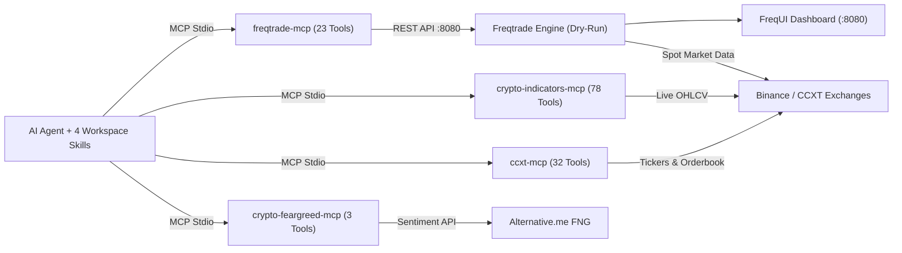

# Quant MCP Trader

> **Autonomous Crypto Paper-Trading Workstation combining Freqtrade, 4 Live MCP Servers (136 Tools), and Bias-Audited Strategy Lab Skills.**

[](https://www.python.org/)
[](https://nodejs.org/)
[](https://github.com/freqtrade/freqtrade)
[](https://modelcontextprotocol.io/)
[](#risk-management--disclaimer)
[](LICENSE)

**Quant MCP Trader** connects modern AI coding assistants (Antigravity, Claude Desktop, Cursor, Windsurf) directly to a **real-time Freqtrade paper-trading bot**, **live CCXT exchange orderbooks**, **50+ technical indicator tools**, and **Crypto Fear & Greed market sentiment** — governed by modular **Agent Skills** and mandatory **lookahead / recursive bias audits**.

Instead of unverified "black-box" trading scripts, every strategy in this repository is benchmarked on real Binance historical OHLCV data and audited with `freqtrade lookahead-analysis` and `freqtrade recursive-analysis` before paper deployment.

---

## Why Quant MCP Trader

- **Real-Time Multi-MCP Intelligence (136 Tools)**: Query live order books across 100+ CCXT exchanges, compute 50+ technical indicators, monitor market Fear & Greed sentiment, and inspect or control your running Freqtrade bot through natural language.
- **Bias-Audited Strategy Pipeline**: Built-in workflow enforces `lookahead-analysis`, `recursive-analysis`, and strategy-level protections (`CooldownPeriod`, `StoplossGuard`, `MaxDrawdown`).
- **Beat a -11.40% Downtrend in Backtesting**: Benchmarking 11 strategies over 79 days (`2026-08-24` to `2026-11-11`) showed why naive strategies fail and how [`UniversalMACDSafe`](user_data/strategies/UniversalMACDSafe.py) achieved **+2.91%** (`73.9%` win rate, `0.01%` closed-trade drawdown, `1.48` Sharpe) while the market fell `-11.40%`.
- **Zero-Risk Dry-Run Default**: Ships strictly in simulated `$1,000 USDT` paper-trading mode with `dry_run: true`, spot-only 1x leverage, and local API security defaults.
- **One-Command Bootstrap**: [`setup.sh`](setup.sh) installs Python 3.12+ dependencies via `uv`, FreqUI 3.3.0, all 4 MCP servers, and generates secure local configs automatically.

---

## System Architecture



---

## Verified Backtest Results & Example Outputs

All strategies were backtested on identical Binance Spot data (`10` USDT pairs, `max_open_trades = 3`, `1,000 USDT` starting balance, `0.10%` exchange fee) from **`2026-08-24` to `2026-11-11` (`79` days, Market Change: `-11.40%`)**:

| Strategy | Timeframe | Trades | Win Rate | Total Profit | Closed-Trade Drawdown | Status |
|---|---|---:|---:|---:|---:|---|
| **`UniversalMACDSafe`** | `5m` | **23** | **73.9%** | **+2.91% (+29.09 USDT)** | **0.01% (0.10 USDT)** | **Active Default** |
| `UniversalMACD` (upstream) | `5m` | 23 | 73.9% | +2.91% (+29.09 USDT) | 0.01% (0.10 USDT) | Baseline (`-31.8%` SL) |
| `CombinedBinHAndCluc` | `5m` | 27 | 77.8% | -5.05% (-50.52 USDT) | 5.05% (50.52 USDT) | Benchmarked |
| `MultiIndicatorStrategy` | `5m` | 115 | 67.8% | -8.91% (-89.07 USDT) | 10.90% (111.46 USDT) | Research Reference |
| `Strategy002` | `5m` | 49 | 87.8% | -8.90% (-89.05 USDT) | 13.21% (138.66 USDT) | Benchmarked |
| `Strategy003` | `5m` | 78 | 89.7% | -9.71% (-97.07 USDT) | 14.47% (151.86 USDT) | Benchmarked |
| `Strategy004` | `5m` | 114 | 92.1% | -10.30% (-102.98 USDT) | 18.25% (198.00 USDT) | Benchmarked |
| `Strategy001` | `5m` | 118 | 86.4% | -10.41% (-104.14 USDT) | 20.44% (230.18 USDT) | Benchmarked |
| `Strategy005` | `5m` | 58 | 77.6% | -12.61% (-126.07 USDT) | 18.70% (200.98 USDT) | Benchmarked |
| `Supertrend` | `1h` | 103 | 46.6% | -21.67% (-216.70 USDT) | 26.24% (278.59 USDT) | Benchmarked |
| `Bandtastic` | `15m` | 481 | 56.1% | -40.09% (-400.94 USDT) | 40.73% (409.85 USDT) | Benchmarked |

### `UniversalMACDSafe` Risk & Audit Output

- **Sharpe / Sortino / Calmar (daily wallet)**: `1.48` / `1.13` / `13.29` | **Profit Factor**: `205.53` | **Max Wallet Drawdown**: `5.29%`
- **Hard Stoploss**: `-8.0%` + `CooldownPeriod` (`6` candles) + `StoplossGuard` (`2` losses / `288` candles) + `MaxDrawdown` (`10%`)
- **Lookahead Analysis**: `No bias` (`0` biased entries, `0` biased exits across `20` signals)
- **Recursive Analysis**: `0.000%` drift across `ma12`, `ma26`, and `umacd` (`startup_candle_count = 200`)

```text
Strategy: UniversalMACDSafe | Trades: 23 | Avg Profit: 0.38% | Tot Profit: +29.089 USDT (+2.91%)
Win/Draw/Loss: 17 / 0 / 6 (73.9%) | Closed-Trade Drawdown: 0.103 USDT (0.01%) | Sharpe: 1.48
```

---

## Quick Start

### Prerequisites

- **macOS / Linux** with **Git**, **uv**, and **Node.js 18+**
- **Python 3.12+** (installed automatically via `uv` if missing)
- On macOS with Homebrew: `ta-lib`, `gettext`, and `libomp` (handled automatically by `./setup.sh`)

### Installation & First Run

Clone the repository and bootstrap Freqtrade, FreqUI, virtual environments, MCP servers, and local configs:

```bash
git clone https://github.com/fsferdows/quant-mcp-trader.git
cd quant-mcp-trader
./setup.sh
```

Download 90 days of Binance historical data, run the backtest with protections, run bias audits, and start dry-run paper trading (`http://127.0.0.1:8080`):

```bash
./run_backtest.sh download
./run_backtest.sh
./run_backtest.sh audit
./run_paper_trade.sh
```

Optionally set your own custom Bot Name, Username, and Password for FreqUI and `freqtrade-mcp`:

```bash
./set_credentials.sh
```

Once running, open **FreqUI** at `http://localhost:8080` and sign in with your configured username and password (from `config.json`, or run `./set_credentials.sh`).

---

## Connected MCP Servers (136 Tools)

All four MCP servers are packaged inside the workspace plugin at [`.agents/plugins/freqtrade-trading/`](.agents/plugins/freqtrade-trading/plugin.json) (template at [`mcp_config.example.json`](.agents/plugins/freqtrade-trading/mcp_config.example.json)):

| Server | Tools | Real-Time Capabilities | Implementation |
|---|---:|---|---|
| **`freqtrade-mcp`** | 23 | `ping_bot`, `fetch_balance`, `fetch_profit`, `fetch_daily_profit`, `fetch_bot_status`, `fetch_market_data`, `start_bot`, `stop_bot`, `stop_buy`, `reload_config`, `add_blacklist`, `delete_blacklist` | [__main__.py](mcp_servers/freqtrade-mcp/__main__.py) |
| **`crypto-indicators-mcp`** | 78 | RSI, MACD, Bollinger Bands, ATR, Ichimoku, Parabolic SAR, Keltner Channel, Stochastic, Vortex, and strategy evaluators over Binance CCXT | [index.js](mcp_servers/crypto-indicators-mcp/index.js) |
| **`crypto-feargreed-mcp`** | 3 | `get_current_fng_tool`, `get_historical_fng_tool`, `analyze_fng_trend` via Alternative.me | [main.py](mcp_servers/crypto-feargreed-mcp/main.py) |
| **`ccxt-mcp`** | 32 | `get_tickers`, `get_orderbook`, `get_ohlcv`, `get_trades`, `search_markets`, `list_exchanges` across 100+ exchanges (spot-only Binance config) | [package.json](mcp_servers/ccxt-mcp/package.json) |

To connect these MCP servers globally in any MCP client (Antigravity, Claude Desktop, Cursor), copy the generated `.agents/plugins/freqtrade-trading/mcp_config.json` entries into your global MCP configuration and reload.

---

## Agent Skills & Guardrails

| Skill | Purpose | Path |
|---|---|---|
| `freqtrade-strategy-lab` | Strategy discovery, data downloads, backtesting, lookahead/recursive audits, hyperopt | [SKILL.md](.agents/plugins/freqtrade-trading/skills/freqtrade-strategy-lab/SKILL.md) |
| `realtime-market-analysis` | Multi-MCP market regime analysis combining CCXT, indicators, Fear & Greed, and Freqtrade candles | [SKILL.md](.agents/plugins/freqtrade-trading/skills/realtime-market-analysis/SKILL.md) |
| `freqtrade-live-operations` | Operating and monitoring the dry-run bot via FreqUI and `freqtrade-mcp` | [SKILL.md](.agents/plugins/freqtrade-trading/skills/freqtrade-live-operations/SKILL.md) |
| `risk-management-guardrails` | Stoploss, position sizing, protections, and pre-live verification rules | [SKILL.md](.agents/plugins/freqtrade-trading/skills/risk-management-guardrails/SKILL.md) |

---

## Risk Management & Disclaimer

- **Paper Trading Default**: `config.example.json` sets `"dry_run": true` and `"force_entry_enable": false`. Never enable live trading or insert exchange API keys without extensive forward-testing and full understanding of financial risk.
- **No Guarantees**: Past backtest performance does not guarantee future results. No automated bot can eliminate market risk or guarantee a 100% win rate.
- **Supported Platforms**: Freqtrade integrates with CCXT-supported cryptocurrency exchanges (Binance, OKX, Bybit, Kraken, etc.) and does not support binary options brokers such as Pocket Option.
- **Educational Use**: Software provided "as is" under the [MIT License](LICENSE); see [THIRD_PARTY_NOTICES.md](THIRD_PARTY_NOTICES.md) for upstream attributions.

---

## Contributing & Community

Contributions are welcome! Please read [CONTRIBUTING.md](CONTRIBUTING.md), follow our [Code of Conduct](CODE_OF_CONDUCT.md), and review [SECURITY.md](SECURITY.md) before opening a pull request or issue:

- [Report a Bug](.github/ISSUE_TEMPLATE/bug_report.md)
- [Propose a Bias-Audited Strategy](.github/ISSUE_TEMPLATE/strategy_proposal.md)

---

## Developer

**FS Ferdows** — Software Engineer & Web Developer (`LateBright` · Dhaka, Bangladesh)

- **GitHub**: [@fsferdows](https://github.com/fsferdows)
- **YouTube**: [@fsferdowsyt](https://youtube.com/@fsferdowsyt?si=03HdUXfd3jfuD0AZ)
- **Email**: [fsferdows@icloud.com](mailto:fsferdows@icloud.com)

If this workstation helped you build, backtest, or connect MCP servers to Freqtrade, consider **starring the repository** and **following [@fsferdows](https://github.com/fsferdows)** on GitHub!

---

## License

Released under the [MIT License](LICENSE) — Copyright (c) 2026 **FS Ferdows**.
